<p align="center">
  
</p>

<!-- BESPOKE DISTRIBUTED ARCHITECTURE SCHEMATIC -->
<p align="center">
  
</p>

<!-- AUTHENTIC TERMINAL SESSION HUD -->
<p align="center">
  
</p>

---

### ⚡ Core Systems & Engineering Focus

```text
┌──────────────────────────────────────────────────────────────────────────────────┐
│  HABIB // SYSTEMS ARCHITECT & AGENTIC INFRASTRUCTURE ENGINEER                   │
│  Specializing in distributed neural compute, GPU inference kernels & autonomous │
│  agent runtimes. Squeezing maximum throughput out of bleeding-edge hardware.     │
└──────────────────────────────────────────────────────────────────────────────────┘
```

* **Cloud GPU Orchestration**: Squeezing hardware limits on **NVIDIA RTX PRO 6000 Blackwell (96GB GDDR7)** via **FlashInfer**, **Triton fused attention**, **vLLM**, and **Automatic Prefix Caching (APC)** for sub-80ms TTFT.
* **Agent-Native Systems**: Contributor and builder across autonomous agent frameworks (**CLI-Anything**, **Hermes Agent**), enabling LLMs to autonomously operate CLI software harnesses with zero human friction.
* **Low-Latency Conversational Voice**: Developing sub-200ms full-duplex neural acoustic models, Indic speech synthesis, and telephony AI agents.
* **Edge-to-Cloud Runtime**: Architecting deterministic SQLite WAL state persistence and high-speed streaming HTTP bridges between local **Termux / Android aarch64** nodes and remote cloud GPU clusters.

---

### 🚀 Flagship Open-Source Projects

<table>
  <thead>
    <tr>
      <th align="left">System / Project</th>
      <th align="left">Architecture &amp; Core Capability</th>
      <th align="center">Stack</th>
      <th align="center">Repository</th>
    </tr>
  </thead>
  <tbody>
    <tr>
      <td><strong>molab-cli</strong></td>
      <td>Autonomous multi-pod cloud GPU orchestrator &amp; workspace persistence engine for NVIDIA Blackwell (96GB VRAM) pods. Features 100% on-pod in-notebook marimo vault, anti-idle keepalive supervisor, and 48-tool MCP JSON-RPC protocol.</td>
      <td><code>Python</code> <code>CUDA</code> <code>vLLM</code></td>
      <td align="center"><a href="https://github.com/w-zo/molab-cli"><code>w-zo/molab-cli</code></a></td>
    </tr>
    <tr>
      <td><strong>CLI-Anything</strong></td>
      <td>Autonomous engine transforming arbitrary software into agent-native CLIs. Leverages AST parsing, trajectory loops, and automatic harness synthesis so LLM agents can run CAD, 3D renderers, and system tools directly.</td>
      <td><code>Python</code> <code>AST</code> <code>Agents</code></td>
      <td align="center"><a href="https://github.com/HKUDS/CLI-Anything"><code>CLI-Anything</code></a></td>
    </tr>
    <tr>
      <td><strong>indic-voice</strong></td>
      <td>Full-duplex real-time conversational voice system with sub-200ms speech synthesis latency, MergeKit acoustic brain architecture, and streaming WebSocket telephony bridges.</td>
      <td><code>PyTorch</code> <code>FastAPI</code> <code>Audio</code></td>
      <td align="center"><code>Private / Research</code></td>
    </tr>
    <tr>
      <td><strong>hermes-agent</strong></td>
      <td>Autonomous multi-agent swarm runtime featuring continuous episodic memory, autonomous skill synthesis, and multi-channel gateway connectivity (Telegram, Discord, CLI).</td>
      <td><code>Python</code> <code>TUI</code> <code>Multi-Agent</code></td>
      <td align="center"><a href="https://github.com/NousResearch/hermes-agent"><code>hermes-agent</code></a></td>
    </tr>
  </tbody>
</table>

---

### 🛠️ Technical Arsenal

```text
Languages     │ Python 3.12+ · Rust 1.80+ · TypeScript · C++20 · CUDA 12.6 · Bash · Go · SQL
Compute & AI  │ vLLM · FlashInfer · PyTorch 2.4 · Triton Kernels · Hugging Face · Transformers
Edge & Host   │ Android Termux (aarch64) · CoreWeave Blackwell · Arch Linux · Docker · gVisor
Protocols     │ Native HTTP SSE Streaming · SQLite WAL · MCP JSON-RPC 2.0 · WebSocket PTY
Storage & Web │ PostgreSQL · Supabase · Redis · Cloudflare Workers · FastAPI · Next.js · Tailwind
```

---

### 🏙️ 3D Contribution Landscape

<p align="center">
  
</p>

---

### 🔬 Architecture Specs & Engineering Protocols

<details>
<summary><b>📐 PROTOCOL 01: THE PREFIX-CACHE STABILITY CONTRACT</b></summary>
<br />

```text
The Prefix-Cache Stability Contract is mandatory across all agentic workloads:
1. Dynamic Variable Isolation: Never inject timestamps, diff counts, or random session IDs
   into base system prompts or tool schemas.
2. 100% Byte-Frozen Prefix: Base prompts and schemas must remain byte-identical across turns.
3. Tail Injection: Dynamic context observations must strictly append at the user turn boundary.
Result: 90%+ Prefix Cache (APC) Hit Rate and sub-80ms Time-To-First-Token (TTFT) on Blackwell 96GB.
```

</details>

<details>
<summary><b>⚡ PROTOCOL 02: HIGH-SPEED STREAMING VS THE PTY BUFFER HAZARD</b></summary>
<br />

```text
The PTY Buffer Hazard: Emulated Linux pseudoterminals (interactive WebSocket PTYs) have a strict
4,096-byte input buffer (MAX_INPUT), silently dropping bytes or hanging on large inputs.
Production Standard:
• Never pipe base64, JSON payloads, or multi-kilobyte code blocks over PTY.
• All high-throughput transfers strictly utilize native chunked HTTP REST streaming (molab push/pull).
• Result: 100% payload integrity at line speed with zero subshell overhead.
```

</details>

<details>
<summary><b>📊 PROTOCOL 03: BLACKWELL 96GB INFERENCE GEOMETRY</b></summary>
<br />

```text
+-----------------------------------------------------------------------------------------+
| NVIDIA RTX PRO 6000 BLACKWELL 96GB GDDR7 -- PRODUCTION TELEMETRY                         |
+-----------------------------------------------------------------------------------------+
| Metric                         | Measured Baseline         | Architecture Target        |
+--------------------------------+---------------------------+----------------------------+
| Time to First Token (TTFT)     | 72ms                      | < 80ms (FlashInfer APC)    |
| Memory Bandwidth Saturation    | 1.76 TB/s                 | 1.80 TB/s (97.8% Peak)     |
| Prefix Cache Hit Rate (APC)    | 94.8%                     | > 90% (Zero-Jitter Loop)   |
| Chunked Prefill Chunk Size     | 512 tokens                | Dynamic Scheduling         |
| Workspace Persistence          | 100% In-Notebook Vault    | Zero Cloud Storage Bill    |
+-----------------------------------------------------------------------------------------+
```

</details>

---

### 🌐 Direct Transmission

<p align="center">
  <a href="https://github.com/w-zo"><strong>GitHub: @w-zo</strong></a> &nbsp;·&nbsp;
  <a href="mailto:tgff28970@email.com"><strong>Email: tgff28970@email.com</strong></a> &nbsp;·&nbsp;
  <a href="https://discord.com"><strong>Discord</strong></a> &nbsp;·&nbsp;
  <a href="https://twitter.com"><strong>X (Twitter)</strong></a>
</p>

<p align="center">
  <sub><code>STATUS: 24/7 AUTONOMOUS KEEPALIVE SUPERVISOR ACTIVE // NOCTURNAL COMPUTE ONLINE</code></sub>
</p>
