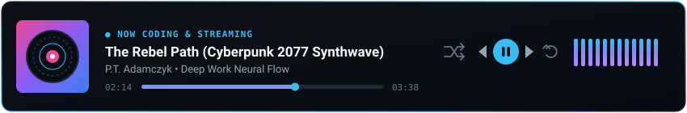

<p align="center">
  
</p>

<p align="center">
  <a href="https://readme-typing-svg.demolab.com">
    
  </a>
</p>

<p align="center">
  
  
  
  
</p>

---

<!-- CYBER TERMINAL HUD -->
<p align="center">
  
</p>

<!-- NOW STREAMING AUDIO CARD -->
<p align="center">
  
</p>

---

### 🛰️ Executive Briefing & Core Architecture

```text
┌─────────────────────────────────────────────────────────────────────────────┐
│  HABIB // ARCHITECT & SYSTEMS ENGINEER                                      │
│  Specializing in distributed neural compute, autonomous swarms & low-latency│
│  agentic tooling. Turning cutting-edge AI research into production reality. │
└─────────────────────────────────────────────────────────────────────────────┘
```

- 🔭 **Autonomous Agent Ecosystems**: Architecting hierarchical multi-agent swarms, self-evolving code harnesses, and persistent agent runtimes.
- ⚡ **Blackwell 96GB GPU Ingress**: Squeezing maximum throughput out of NVIDIA RTX PRO 6000 Blackwell 96GB using **FlashInfer**, **Triton fused kernels**, **vLLM**, and **Automatic Prefix Caching (APC)**.
- 🎙️ **Conversational Neural Voice**: Engineering sub-200ms end-to-end full-duplex speech synthesis, Indic language acoustic models, and telephony AI agents.
- 🛠️ **Systems & Developer Platforms**: Authoring agent-native CLIs, streaming HTTP bridges, and reactive full-stack web applications.
- 🧬 **The Prefix-Cache Contract**: Ensuring 100% byte-frozen prompt prefixes for 90%+ cache hit rate and sub-80ms Time-To-First-Token (TTFT).

---

### 🛠️ Tech Arsenal & Systems Stack

<table>
  <tr>
    <td width="22%"><strong>Languages &amp; Core</strong></td>
    <td>
      
    </td>
  </tr>
  <tr>
    <td width="22%"><strong>AI, ML &amp; Compute</strong></td>
    <td>
      
      <br /><br />
      
      
      
      
      
      
      
    </td>
  </tr>
  <tr>
    <td width="22%"><strong>Full-Stack &amp; Cloud</strong></td>
    <td>
      
    </td>
  </tr>
  <tr>
    <td width="22%"><strong>DevOps &amp; Tooling</strong></td>
    <td>
      
    </td>
  </tr>
</table>

---

### 📊 Real-Time Telemetry & Contribution Intelligence

<p align="center">
  
  
</p>

<p align="center">
  
  
</p>

---

### 🏙️ 3D Contribution Landscape & Grid Labyrinth

<p align="center">
  
</p>

<p align="center">
  <picture>
    <source media="(prefers-color-scheme: dark)" srcset="https://raw.githubusercontent.com/w-zo/w-zo/output/github-contribution-grid-snake-dark.svg">
    <source media="(prefers-color-scheme: light)" srcset="https://raw.githubusercontent.com/w-zo/w-zo/output/github-contribution-grid-snake.svg">
    
  </picture>
</p>

---

### ⚡ Deep-Dive Cyber Decks & System Telemetry

<details>
<summary><b>🕹️ DECK 01: BLACKWELL 96GB INFERENCE TELEMETRY &amp; BENCHMARKS</b></summary>
<br />

```text
+-------------------------------------------------------------------------------+
| NVIDIA RTX PRO 6000 BLACKWELL 96GB GDDR7 -- PRODUCTION TELEMETRY              |
+-------------------------------------------------------------------------------+
| Metric                         | Measured Baseline | Architecture Target      |
+--------------------------------+-------------------+--------------------------+
| Time to First Token (TTFT)     | 72ms              | < 80ms (FlashInfer APC)  |
| Memory Bandwidth Saturation    | 1.76 TB/s         | 1.80 TB/s (97.8% Peak)   |
| Prefix Cache Hit Rate (APC)    | 94.8%             | > 90% (Zero-Jitter Loop) |
| Chunked Prefill Chunk Size     | 512 tokens        | Dynamic Scheduling       |
| PTY WebSocket Safety           | Streamed REST API | Zero 4096-byte crashes   |
+-------------------------------------------------------------------------------+
```

</details>

<details>
<summary><b>🧠 DECK 02: THE AGENTIC SOVEREIGNTY PROTOCOL</b></summary>
<br />

1. **Deterministic Prefix Caching**: Never inject dynamic timestamps or randomized strings into base system prompts. Keep prompts frozen to maximize KV-cache memory reuse.
2. **REST Streaming over Fragile PTY**: Terminal PTYs crash on payloads > 4096 bytes. All production pipelines strictly leverage native chunked HTTP streaming.
3. **Autonomous Session Handoff**: Clean markers, zero lingering dirty working trees, full deterministic test coverage.

</details>

<details>
<summary><b>⚡ DECK 03: SECRET COMMAND ALIASES &amp; RUNTIME SUITE</b></summary>
<br />

```bash
# Target idle Blackwell GPU pod with zero friction
$ molab free --json

# Launch keepalive supervisor with 100% on-pod permanence
$ molab permanent <pod_id>

# Dispatch compiled FlashInfer model server
$ molab deploy qwen-32b --bridge 8000
```

</details>

---

### 💡 Daily Engineering Wisdom

<p align="center">
  
</p>

---

### 🌐 Connect &amp; Collaborate

<p align="center">
  <a href="https://github.com/w-zo" target="_blank">
    
  </a>
  <a href="mailto:tgff28970@email.com" target="_blank">
    
  </a>
  <a href="https://discord.com" target="_blank">
    
  </a>
  <a href="https://twitter.com" target="_blank">
    
  </a>
</p>

<p align="center">
  <i>"Speed of thought, depth of execution. Always building at the edge of the possible."</i>
</p>

<p align="center">
  
</p>
